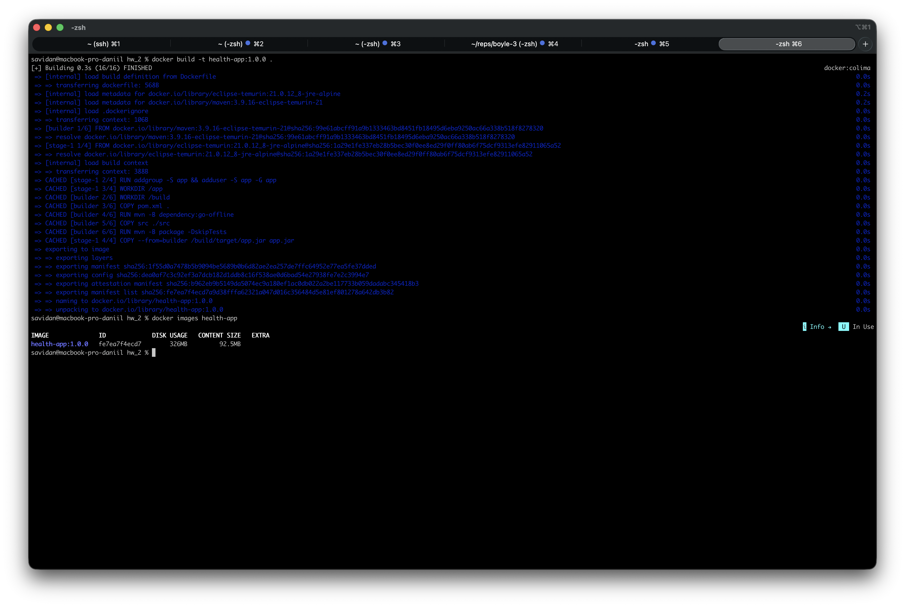
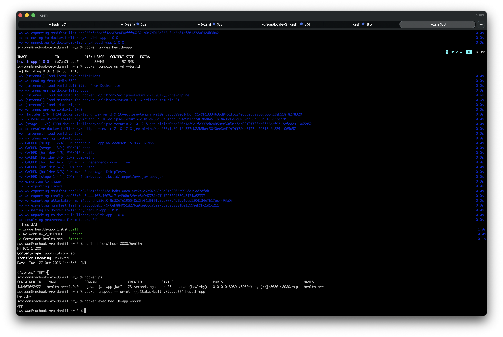

# Лабораторная работа №2

Приложение на Spring Boot 3.5 с одним эндпоинтом `GET /health`, который возвращает `{"status":"UP"}`.

## Сборка

```bash
cd hw_2
docker build -t health-app:1.0.0 .
docker images health-app
```

## Запуск

**Через docker-compose:**

```bash
docker compose up -d --build
```

**Через docker:**

```bash
docker run -d --name health-app -p 8080:8080 -e SERVER_PORT=8080 health-app:1.0.0
```

## Проверка

```bash
curl -i localhost:8080/health
docker ps
docker inspect --format '{{.State.Health.Status}}' health-app
docker exec health-app whoami
```

## Остановка

**Через docker-compose:**

```bash
docker compose down
```

**Через docker:**
```bash
docker rm -f health-app
```

## Выгрузка образа в registry

```bash
docker login
./build_and_push.sh docker.io/<имя юзера>/health-app 1.0.0
```

## Скриншоты



